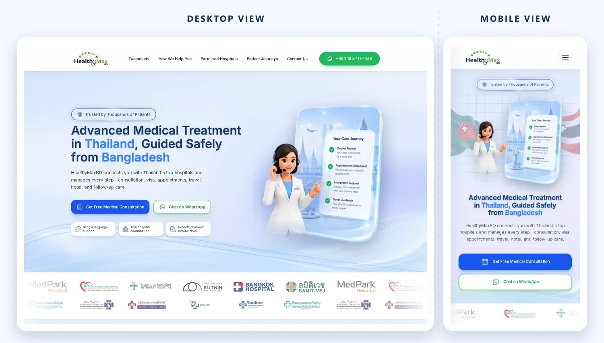
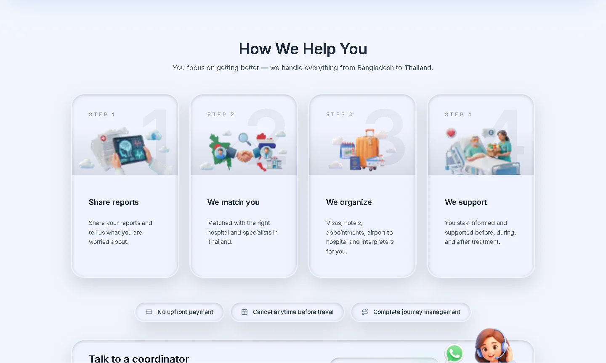
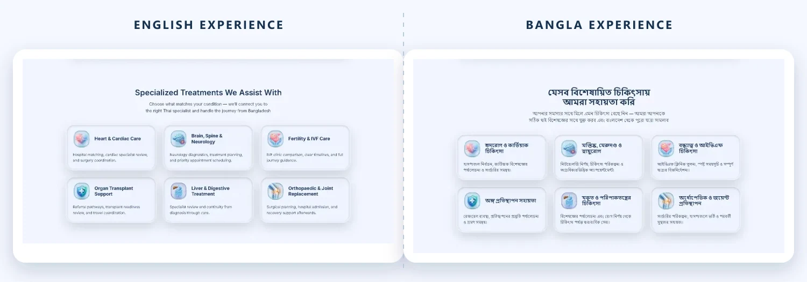
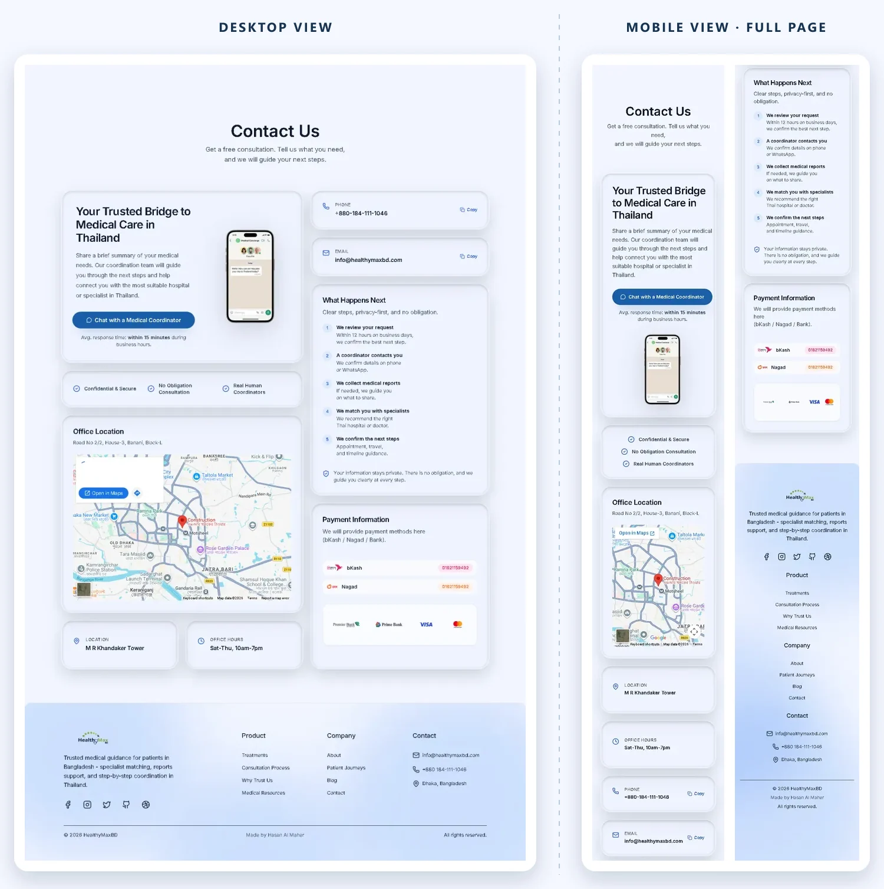
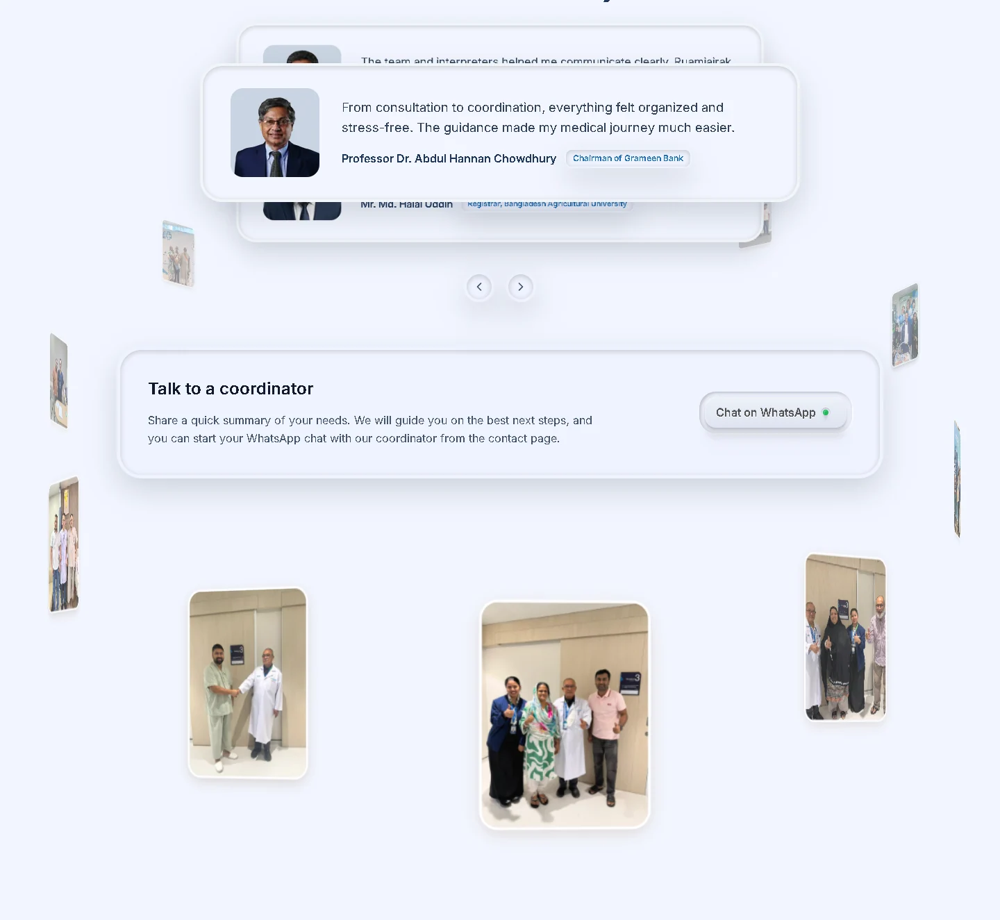
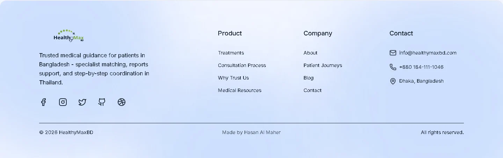

# HealthyMaxBD

### A bilingual healthcare journey for Bangladeshi patients seeking treatment in Thailand

HealthyMaxBD turns a complex cross-border care process into a clear, reassuring digital experience—from treatment discovery and report review to hospital coordination, travel guidance, and follow-up support.

## Project overview

HealthyMaxBD is the digital front door for a patient-assistance service connecting people in Bangladesh with medical care in Thailand. The product presents a sensitive, multi-stage journey in a calm and approachable format, helping patients understand available treatments, how coordination works, and where to begin.

The experience is live in English and Bangla, works across desktop and mobile, and gives every page a clear route to consultation.

## The experience at a glance

- **Understand the process** — A four-step journey explains report sharing, specialist matching, travel coordination, and ongoing support.
- **Explore relevant care** — Specialized and supporting treatment areas use a consistent card system that remains easy to scan.
- **Move forward confidently** — Consultation actions, hospital visibility, patient stories, and direct contact details support the next decision.

## Bilingual by design

Localization is treated as a complete product experience rather than a text swap. Both routes retain the same information architecture, branded components, treatment pathways, and consultation flow while accommodating the different rhythm and typography of English and Bangla.

## Contact and conversion flow

The contact experience answers the questions that matter at the point of action: how to reach a coordinator, what happens next, where the office is located, and which consultation channels are available. Desktop and mobile layouts preserve the same sequence while adapting the information density for each screen.

## Trust made visible

The homepage combines a testimonial carousel with an animated patient gallery. This creates social proof without interrupting the consultation journey and gives authentic outcomes a prominent place in the product story.

## Technology and delivery

  
  
  
  
  

The production experience uses a locale-aware Next.js application deployed on Vercel. Public routes, responsive behavior, metadata, language alternates, and optimized production assets were verified against the live website.

## My contributions

I built and delivered HealthyMaxBD as a production web experience, with responsibility centered on:

- Translating the service journey into a clear product structure and visual system.
- Building the responsive interface across desktop and mobile breakpoints.
- Implementing parallel English and Bangla experiences with consistent navigation and content hierarchy.
- Designing reusable presentation patterns for treatments, process steps, trust signals, and consultation actions.
- Preparing and maintaining the production experience on Vercel.

## Selected engineering challenges

**Maintaining bilingual parity.** English and Bangla have different text density and typographic behavior. The interface keeps both versions visually balanced without changing the core journey.

**Making a complex service feel manageable.** Cross-border medical coordination contains many decisions and dependencies. Progressive content sections, repeatable cards, and clear calls to action turn that complexity into an understandable path.

**Preserving hierarchy across screen sizes.** Treatment catalogs and trust content become dense on mobile. The responsive system reflows navigation, imagery, cards, and consultation prompts while preserving reading order.

## End-to-end polish

The visual system continues through the final interaction: navigation, content cards, contact details, social links, and footer structure share the same spacing, typography, and soft clinical palette.

## Explore the product

- [English website](https://healthymaxbd.com/en)
- [Bangla website](https://healthymaxbd.com/bn)
- [Hasan Al Maher — portfolio](https://hasanalmaher.com)

---

Curated project case study. Production source code and internal implementation details remain private.

